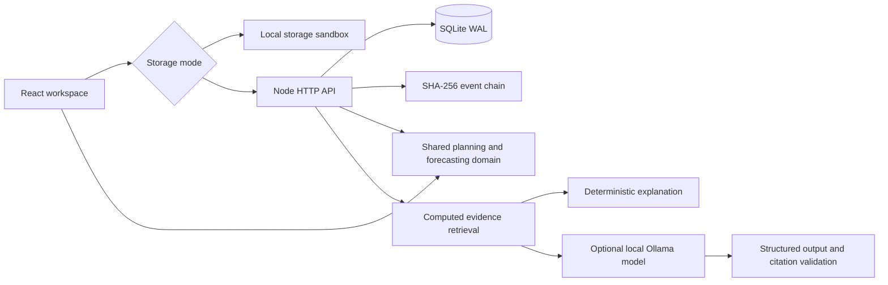

# Reflow by SwiftCart

**Put the inventory you already own where customers actually need it.**

Reflow replaces the original SwiftCart storefront with an inventory recovery workspace for a small retail network. A planner finds excess stock and unmet demand across locations, proposes economically useful transfers, and takes an operator from evidence review to reservation and receipt.

This is a runnable engineering prototype, with **synthetic data**, real planning calculations, durable local API storage, and optional local language-model explanations. It is not a production deployment or a claim of achieved customer savings.

The interface includes a high-contrast navigation rail, responsive layouts, visible storage mode, contextual exports, and URL-based navigation that survives refresh and browser back/forward. Browser settings offer a stored-data backup and an explicitly confirmed demo reset. Open tabs synchronize decisions, and stale API writes refresh the current workspace instead of leaving the operator on an unusable recommendation.

## Run it

Requires **Node.js 22.13+** (tested on 22.20) and npm. The SQLite API is built into Node; no MongoDB, paid model API, or backend dependency install is needed.

```sh
npm ci --prefix client
npm run dev
```

Open the printed local URL, normally **http://127.0.0.1:5173**. This starts the explicitly labeled **browser sandbox**. Review decisions, approve transfers, confirm receipt, run scenarios, ask the deterministic copilot, and inspect backtests. Decisions survive refresh in this browser's local storage.

For the SQLite-backed workspace, copy `.env.example` to `.env`, set a long random `OPS_API_TOKEN`, and run:

```sh
npm run build
npm start
```

Open **http://127.0.0.1:8080**, then enter the same token in **Workspace settings** to authorize approvals, receipts, simulations, and copilot requests. The token stays in tab memory. SQLite writes to `data/reflow.sqlite` by default. For frontend development against the API, run `npm run server` and `npm run dev` in separate terminals; the Vite proxy forwards `/api` requests.

## The product

| Workspace | Working behavior |
| --- | --- |
| Overview | Computed exposure, excess capital, recovery opportunity, network schematic, demand chart, and activity |
| Decision inbox | Search/filter routes, inspect evidence and economics, approve or dismiss |
| Inventory network | All 48 stock positions, daily velocity, physical stock, inbound stock, cover, and risk |
| Scenario lab | Demand shocks, transit disruptions, freight budgets, and planning horizons; no mutation |
| Transfer orders | Donor reservation on approval; destination credit only on confirmed receipt |
| Operations copilot | Lexical evidence retrieval, deterministic explanations or optional Ollama generation, cited facts |
| Model evaluation | Recomputed rolling-origin backtests, WAPE baseline comparison, empirical interval coverage, model card |
| Decision ledger | Ordered approvals, dismissals, and receipts; exportable request IDs and planner versions |
| Data intake | Validated full-snapshot CSV ingestion, provenance labels, atomic replacement, and import events |

The seed contains **8 products × 6 Indian locations × 84 daily observations**. Product names, stock quantities, demand, freight rates, transit times, and all potential benefits are illustrative. No Straive data is used. The Data intake screen exports a wide CSV template with `product_id,location_id,stock,sales_day_1,…,sales_day_84`. Update all 48 rows to import non-sensitive observations; the existing catalog, margins, and location IDs remain fixed. Historical sales must be ordered oldest to newest and cover 84 consecutive days. Import validates every field before changing state, rejects incomplete/duplicate/unknown positions, blocks pending reservations, archives old dismissals, and records provenance in the audit trail. Imported data is not labeled synthetic; financial estimates still use demo margins and carrier assumptions.

## Architecture



- `client/src/domain/`: seeded data, forecast, planning, decision state machine, evaluation, and retrieval. The browser and API share this implementation.
- `client/src/workspace/`: responsive React interface and storage adapter. Vite replaces the previous Create React App build.
- `ops/`: dependency-free Node API, SQLite transactions, audit integrity check, and optional Ollama adapter.
- `tests/`: forecast, resource constraints, reservation/receipt invariants, idempotency, stale-write rejection, persistence, tampering detection, API auth, origin checks, CSV validation, and mocked model-output validation.
- `client/e2e/`: desktop operator workflow, reload persistence, simulation, copilot evidence, evaluation, CSV intake, mobile layout, authenticated API workflows, stale-write recovery, zero-demand charts, navigation history, corrupt storage recovery, cross-tab synchronization, and export contents.

Original storefront modules remain in the repository for reference but are outside the new application entry point. The old Express/MongoDB server is not started or deployed by the new scripts. Their historical dependencies are removed from the active package manifests.

## Forecasting and optimization

**Forecast:** a seasonal naive baseline averages the same weekday over the last three weeks. A rolling calibration set of up to 42 past one-step residuals supplies an absolute-error radius at a 90% nominal level, with a finite-sample quantile correction. This is inspired by conformal methods, but **temporal dependence means exchangeability and distribution-free coverage are not established**. The UI reports empirical coverage, not a guarantee. The chart's aggregate band is illustrative, not a calibrated joint interval.

**Planning:** estimate unmet horizon demand after available stock and reserved inbound transfers. A donor keeps the horizon demand plus three extra days and a residual buffer. Candidates are bounded by donor surplus, destination unmet demand, and post-arrival demand. Freight is an explicit illustrative function of schematic distance and units. Positive-net candidates are greedily ranked by benefit/freight and selected within the run's budget. Capacity is conservatively reserved while generating candidates; skipped budget candidates can leave unused capacity. This heuristic is intentionally inspectable and **does not claim global optimality**. Budgets apply to each proposed plan, not an accounting period.

**Value:** protected contribution is transferable units × unit contribution margin; net benefit subtracts estimated freight. No gross merchandise value is presented as actual profit or realized savings. The model does not simulate lost sales before arrival, uncertain arrivals, holding costs, substitution, or returns.

**Evaluation:** origins at days 56, 63, 70, and 77 each predict seven unseen days. The model and calibration at each origin see only its past. On the fixed synthetic seed:

| Measure | Result |
| --- | ---: |
| Held-out predictions | 1,344 |
| Seasonal baseline WAPE | 15.53% |
| Seven-day mean WAPE | 15.68% |
| Empirical interval coverage | 95.09% |

Run `npm run evaluate` to reproduce. These numbers describe the synthetic generator only; the small WAPE difference is not evidence of a meaningful production advantage.

## Accountable writes

Approvals remove units from donor availability and create a reserved transfer. Receipts add those units to destination availability once. Reserved inbound units reduce future unmet demand, preventing duplicate allocation. Across approval and receipt, physical units plus reserved units are conserved.

Writes require `expectedVersion` and `requestId`. Identical retries return the existing state; reuse for a different operation fails. Stale revisions return HTTP 409. SQLite applies the state change and event insert in one `BEGIN IMMEDIATE` transaction. A unique request ID prevents duplicate audit inserts. A server-assigned operator identity prevents client impersonation within this single-operator prototype.

`GET /api/ops/audit/verify` checks event ordering, SHA-256 chaining, and consistency with the workspace snapshot. **This detects accidental/local tampering, not a privileged attacker who can rewrite the database and recompute hashes.** External anchoring, retention policies, and per-user identities are future production requirements.

## Optional local language model

Run an Ollama installation with a model that supports structured output. Set its exact installed model name in `.env`:

```dotenv
OLLAMA_MODEL=your-installed-model
OLLAMA_URL=http://127.0.0.1:11434
```

Restart the API. The copilot retrieves up to three computed planning records, supplies them as context, and asks for schema-constrained JSON with known citation IDs. Temperature is zero, requests time out after 30 seconds, and invalid citations or malformed outputs fail explicitly. No model can move stock or issue purchase orders. Keys and model URLs never enter the client bundle.

Without `OLLAMA_MODEL`, both modes return an honestly labeled deterministic explanation. This fallback is not an LLM, semantic search, or an autonomous agent. Schema and citation validation do not prove textual/numerical faithfulness; human review remains necessary. The live Ollama path requires a separately running model and is not included in the default offline verification.

## API

| Method | Endpoint | Purpose |
| --- | --- | --- |
| GET | `/api/health` | Health and storage type |
| GET | `/api/ops/workspace` | Full demo workspace |
| GET | `/api/ops/evaluation` | Recomputed backtest metrics |
| GET | `/api/ops/audit/verify` | Audit chain and snapshot integrity |
| POST | `/api/ops/decisions` | Approve or dismiss a current recommendation |
| POST | `/api/ops/receipts` | Receive a reserved order |
| POST | `/api/ops/simulate` | Read-only scenario planning |
| POST | `/api/ops/copilot` | Grounded explanation |
| POST | `/api/ops/import` | Validate and atomically replace a full inventory snapshot |

All POST endpoints require `Authorization: Bearer <OPS_API_TOKEN>`. Reads deliberately expose synthetic demo data. Mutation requests are body-limited and rate-limited, and cross-origin writes are rejected unless explicitly configured. The API binds to loopback by default. This single-workspace authentication is not enterprise RBAC or tenant isolation. Do not load private operational data or expose it as a production service without implementing those controls.

## Verify

```sh
npm test
npm run build
npm run evaluate
node client/node_modules/@playwright/test/cli.js install chromium
npm run test:e2e
```

The browser suite runs the static sandbox on port 5173; stop any API on 8080 so the proxy does not select server mode. Backend tests use isolated temporary/in-memory databases.

The verified suite contains **17 domain/API tests and 12 browser tests**. Regression cases cover the selected chart horizon, finite SVG coordinates with all-zero demand, scenario invalidation after a horizon change, simulation-specific exports, filtered inventory exports, and operator-token recovery. The demand chart uses the same 7/14/30-day horizon as the planner. Simulation results and copilot evidence explicitly account for planning-context changes.

## Deploy

**Vercel:** the root and client Vercel configs build the static sandbox. Use repository root or `client` as the project root with the corresponding config. Browser decisions persist per device; they are not shared across visitors. SQLite and Ollama are **not** deployed to Vercel. A Git push can trigger a connected Vercel deployment; confirm the deployment result in Vercel before treating production as updated.

**Full API:** use Node 22 with a persistent writable disk, or build the provided container:

```sh
docker build -t reflow .
docker run --rm -p 8080:8080 --env-file .env -e HOST=0.0.0.0 -e OPS_DB_PATH=/app/data/reflow.sqlite -v reflow-data:/app/data reflow
```

Place a TLS reverse proxy in front before external use. SQLite is suitable for this single-instance prototype; a multi-instance production deployment needs a shared transactional store, identity, migration management, backups, ingestion jobs, and observability.

## Research and decisions

1. [Duan, Hu & Jiang — Ask, Clarify, Optimize (2026)](https://arxiv.org/abs/2601.00121): motivates separating LLM interpretation from numerical optimization. Reflow applies the separation principle; it does not reproduce the paper's system or claim its measured cost reductions.
2. [Angelopoulos & Bates — A Gentle Introduction to Conformal Prediction (2021, revised 2022)](https://arxiv.org/abs/2107.07511): motivates explicit uncertainty and residual calibration; Reflow documents the time-series limitation rather than borrowing guarantees.
3. [Ollama — Structured outputs](https://ollama.com/blog/structured-outputs): schema-constrained local explanations. Output structure is validated independently of language-model prose.

## A truthful resume description

> Rebuilt a legacy commerce app into an inventory recovery platform with a shared forecasting/planning engine, budget-constrained stock transfers, rolling-origin evaluation across 48 synthetic series, a transactional SQLite reservation/receipt workflow, idempotent APIs, an integrity-checked event ledger, and an optional evidence-grounded local LLM copilot.

Do not claim commercial savings from the dashboard's simulated opportunity values. The strongest next experiment is to add a licensed retail dataset, ingest real stock positions and lead times, compare against a min-cost-flow baseline, and measure out-of-sample decision cost under stockout censoring and distribution shift.
